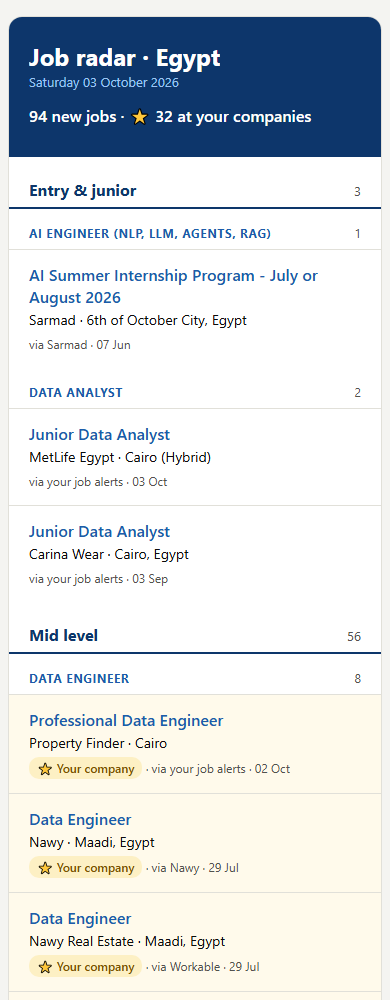
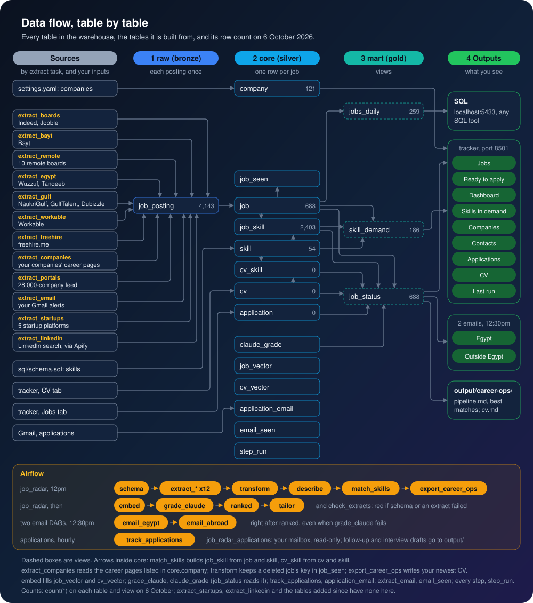
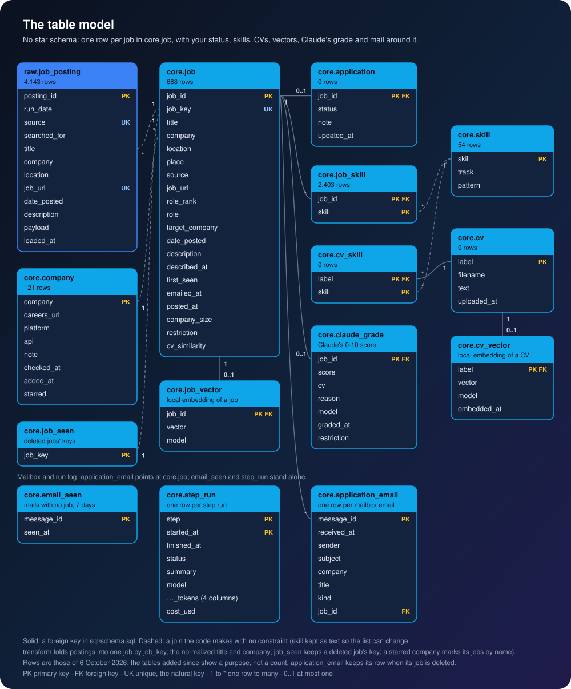
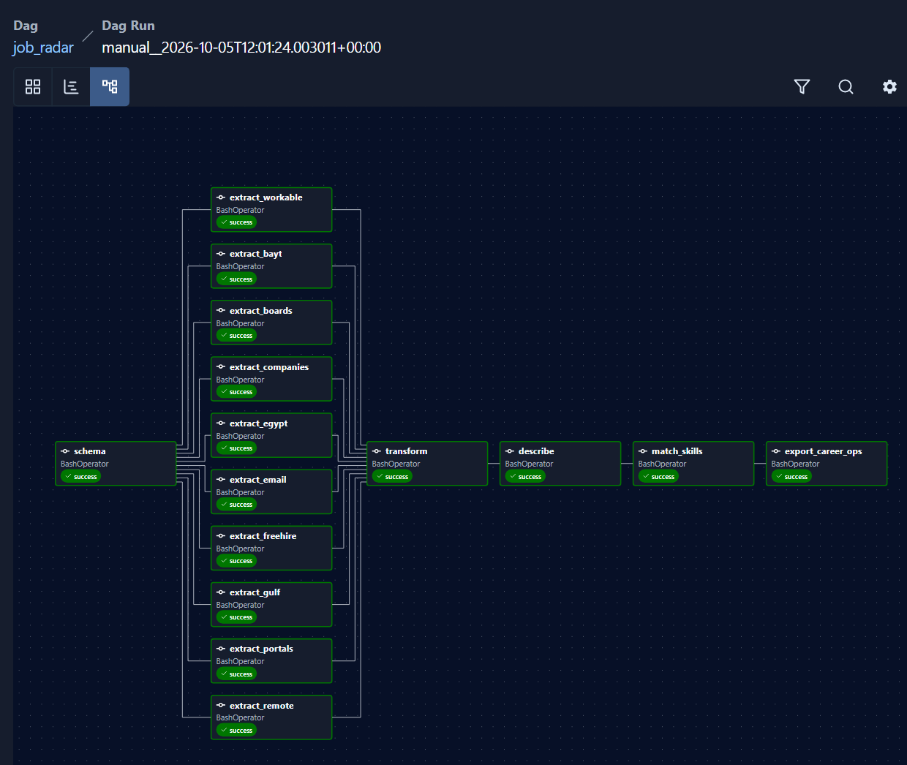

<p align="center">
  
</p>

<p align="center">
  
</p>

<p align="center">
  
  
  
  
  
  
</p>

<h3 align="center">Your own job search, on autopilot: every new data and AI job from 28 sources,<br>ranked by your skills, in two emails a day.</h3>

<p align="center">
  
  
  
  
  
</p>

<p align="center">
  <a href="GUIDE.md"></a>
</p>

## 📬 What you get



**Two emails, each with only the jobs you have not seen**

- 🏠 **Egypt** · right after the 12pm collect (Cairo time): onsite and hybrid jobs in Cairo or Giza, and
  Egypt's remote jobs
- 🌍 **Outside Egypt** · right after it too: remote jobs in the Gulf, Europe, the USA, Canada and worldwide

The further you scroll, the more experience a job asks for: **Entry & junior → Mid level →
Senior**, best match first in each; your roles in your order; full-time, part-time, contract and
freelance. Jobs at your companies get a ⭐.

**Also on your laptop**

- 📋 **Tracker**, port 8501: filter jobs (by role, place, the board in Egypt or the Gulf, and age: within
  12 or 24 hours, over 1, 2 or 3 days, or *deleted tomorrow*), mark saved / applied / interview / offer,
  see the skills each role asks for, Claude's score and why, the drafts ready to apply, your applications' funnel, your contacts, upload your CV, see how each company's careers page is read and each step's last run.
  Jobs you cannot legally take from Cairo are hidden (the board's own "who can apply" field, else Claude Haiku), and your
  applications are counted by company from your mailbox: applied, interviews, rejections, offers, and the ones that ghosted you.
- 🌀 **Airflow**, port 8081: every run, every task's log, and *Trigger* to run now.
- 🤖 **Claude**, `/job-radar` in Claude Code: reviews your matches, tailors your CV, helps you apply.
- 🗄️ **SQL**, port 5433 (database and user `jobradar`): query the `mart` views.

<br clear="right">

## 🧭 How it works

<p align="center">
  
</p>

The machine in four diagrams (two ways to run, a mind map of the sources, the pipeline, the
request ladder) and where to change what: [docs/architecture.md](docs/architecture.md).

<details>
<summary><b>📐 The rules that decide what reaches you</b></summary>
<br>

- **Roles:** a title must fit one of your roles; titles above your level or never yours are left out.
  A LinkedIn alert's jobs are all kept (LinkedIn chose them for your alert), after your roles.
- **Places:** onsite or hybrid only in Egypt, in your onsite areas (Cairo, Giza ...); anywhere else
  the job must be remote: hybrid, onsite and "not remote" never count as remote. The place comes
  from the search, else the location, else the title; a job alert whose place cannot be told
  stays only when it says remote.
- **No duplicates:** a posting is stored once (source + link); a job is one row (its normalized
  title + company), so the same job on three boards, or reposted, is one job; each job is emailed once.
- **Light on the laptop:** the scrapers run one by one (a collect takes about 15 minutes); each step
  stops at its time budget and leaves the rest for the next run. A job first seen over 5 days ago is
  archived whole in `core.job_archive` and removed from the tracker, unless you noted or applied to it (its key stays, so it is never emailed again). A collect missed while the laptop slept runs once it wakes.
- **Every public page is read**, whatever a site's robots.txt says; a site that turns scripts away
  is asked again with a real Chrome's handshake. The code never logs in and never gets past a bot
  check: a site that shows one is opened by you once (`scripts/open_blocked.py`) and read with your
  saved session after that. LinkedIn is never opened from the laptop: its jobs come from your alert
  emails and from its logged-out search through Apify. A
  careers page that cannot be read shows why in the tracker and is tried again a day later.

</details>

## 🗓️ A day with job-radar

<p align="center">
  
</p>

| Airflow DAG | When | Does |
|---|---|---|
| `job_radar` | 12pm | extract (12 tasks, one by one) → transform → describe → match_skills → eligibility → embed → grade_claude → ranked → tailor; match_skills → export_career_ops; check_extracts turns the run red when `schema` or an extract did not succeed |
| `job_radar_email_egypt` | right after grade_claude, red or green (a Trigger's only with features.manual_collect_emails) | emails Egypt's new jobs |
| `job_radar_email_abroad` | right after grade_claude, red or green | emails everywhere else's new jobs |
| `job_radar_applications` | every hour | reads your mailbox (read-only) for news on your applications |
| `job_radar_backup` | 3am | `pg_dump` of the `core` and `raw` schemas to `output/backups/nightly-<day>.dump` (restore with `pg_restore`); the newest 14 are kept |

With the warehouse down, every step prints "the warehouse is unreachable, skipped" and exits 99, Airflow's skip code: the run's tasks are skipped, not red, and the next run catches up.

Claude grades the jobs of every place in this schedule and drafts only for Egypt's (`ai_places: [Egypt]` in `settings.yaml`). With features.eligibility on, a job someone living in Cairo cannot legally take is never stored (every extract drops it before it reaches raw.job_posting) when its board's own "who can apply" field bars Egypt or its location ties it to the USA, Canada or Europe, else hidden, not deleted: the eligibility step (after match_skills) reads the board's own "who can apply" field where it has one (Daily Remote, Remotive, Jobicy, Remote.co, Himalayas, We Work Remotely, Relomote, Wellfound: a list without worldwide, EMEA, MENA, Africa, the Middle East, Egypt or Cairo's time zone bars it), else asks Claude Haiku once per described job outside ai_places (yes, no or unclear; only no hides; about $0.70 a month), and the tracker and the emails leave it out (switch on *Show hidden jobs* in the tracker to see it). Claude's own restriction hides a job the same way (also only with eligibility on), and a status you set shows it again.

grade_claude has Claude (Sonnet 5.5) grade the jobs with a description, in any place, closest to your CV first (embed's free `cv_similarity`), with no daily cap, 0-10 against your CV with one line why, learning from your last 30 clicks in the tracker: a grade costs about $0.015. match_skills reads the years of experience each posting asks for from its text (the most of several lower bounds: "4+ years ... 3+ years of PySpark" is 4) into core.job.years_required, and Claude gives it when the text names none in digits; the Jobs page shows it as Years, and the score's reason names a mismatch first ("asks 5+ yrs, CV shows about 2"). A job graded 8 or more in its first 12 hours since posted is pushed to your phone through [ntfy.sh](https://ntfy.sh) when `NTFY_TOPIC` is set. Claude grades only jobs that have a description. LinkedIn pages are never opened, so paste the description in `/job-radar` to get a grade. A grade made before your newest CV upload counts as ungraded and is overwritten on the next run. A job scored 3 or lower is hidden with features.auto_hide on, in the tracker (a sidebar toggle shows it) and in the emails; each email opens with its Top 5 (scores 7+), and the Egypt one with the applications to follow up (sent 7 or 14 days ago, no answer yet). Each job card in the email lists the skills it asks for that your best CV shows, and the ones it does not ("Not on it"); the tracker's Jobs page shows the missing ones as "Not on your CV". grade_claude turns its task red when it selected jobs and graded none (a wrong key, no credit or no network).

tailor writes cv.md, cv.html, cover-letter.md, cover-letter.html, notes.md and two one-page A4 PDFs (`<name> <Company> <DE|BI|DA|AI>.pdf` and its `Cover Letter.pdf`, printed by headless Chromium) to `output/applications/<day>/<company>-<title>/` for up to 5 jobs a run scoring 8+ in ai_places, and marks them saved ('draft ready <day>'). The CV follows your rules: the summary's pattern (role, years, stack, background, track record), bullets that lead with the outcome and use only facts your CV backs, the fixed dates and links. Two checks run in code: a CV or cover letter that names a gap ("I have not", "no experience", "lack" ...) is thrown away and drafted again next run, and a CV PDF over one page or missing a link (pypdf `/Annots`) is left in its folder, not marked ready, and turns the task red. `tailor.tailor_job(conn, job_id)` drafts a job you name. The Ready to apply page shows each draft with one Apply link (the employer's or original board's page when the source gives it, else the careers page of a company you track when the link is only a board listing, else the job's link), the CV, letter and notes, and a Mark applied button that sets the job applied and takes it off the list. About $0.07 a draft.

embed (features.embeddings) gives each job with a description, in any place, and each CV, a local nomic-embed-text vector (Ollama, $0, on the CPU) in core.job_vector and core.cv_vector. It sets core.job.cv_similarity (cosine to the closest CV); a CV is embedded again only when it changed. If Ollama isn't running, it skips and stays green.

track_applications (hourly DAG job_radar_applications) reads the All Mail of every Gmail account in `MAILBOXES` (else `GMAIL_USER`) read-only over IMAP for application news (subjects with application or job-offer words, and every email from the people and domains in `APPLICATION_SENDERS`; a mailbox with nothing stored yet is read 400 days back, the others 3 days; each row keeps its `mailbox`): confirmations, views, interviews, rejections, offers. Rows go into core.application_email, one per message. Plain sender and subject patterns classify most emails; Claude gets only the leftovers (2,000 chars each), with rules for each kind and the mailbox's own address, so your own replies and forwards count as other. An email that names no company takes its listed sender's. An email moves its job's status in core.application up only, and only when it names that job (the same title at a company of the same name: "Boston Consulting Group (BCG)" is BCG X, "SourceQS (recruiter)" is SourceQS) or the company's only job seen before the email. Each run also matches again the stored emails that have no job yet. Switch: features.track_applications. Newsletters with no jobs are remembered in core.email_seen for 7 days, so the next run does not download them again.

- **Follow-up drafts:** when features.follow_up_drafts is on, an application with no answer exactly 7 or 14 days (Cairo calendar days, as in the Egypt email) after its first confirmation email gets a draft in `output/followups/<day>/`, in your voice from your CV; never sent. The tracker's Follow up list shows the same ones: exactly 7 or 14 Cairo days, as in the email.
- **Outreach drafts:** when features.outreach_drafts is on, each startup role (a company in `output/startups/startups.csv`) that Claude scored 7+ gets a short cold email to its founder (else its head of data or engineering) in `output/outreach/`, in your voice from your CV; never sent. Only a company with a Founder or Hiring row and an email in `data/contacts.csv` gets one; `python -m job_radar.research founders` finds the rest from the company's own site and the press (never LinkedIn) and adds them there.
- **Interview prep:** when features.interview_prep is on, interview notes are written from the interview email's own text (fetched read-only) and the matching job's description, never from anything else; a section with no source says 'No detail given in the email'; once per company and title; notes the checks throw away are asked for again the next day, not every hour. They land in `output/interviews/<company>-<title>/notes.md`.
- **In the tracker:** the Applications page counts companies (an offer thread of many emails is one offer), those that hired you (an offer signed, a welcome aboard) and those that ghosted you (applied 30+ days ago, no interview, rejection or offer since), shows the funnel (applied → viewed → interview → offer, by month and by channel) and a Drafts list of these files; the Contacts tab lists recruiters and hiring managers from `data/contacts.csv` (gitignored; nothing sends).

A job is one row however the boards write its company: the key ignores spacing, case, "and" and legal suffixes ("Care Access" and "careaccess", "J.D. Power" and "JD Power" are one job). Before transform deletes a job, it writes a slim line to core.job_history (key, first and last seen, board, role, place, score, the day its page was found closed; no description), which the Market page's Over time charts read: jobs a week and days to close by role.

Every extract records how many postings each board gave and how many it dropped as not for Egypt (core.extract_count); a board that suddenly drops all of 10 or more (its last 7 days kept some), or none where the last 7 days dropped half, prints a WARNING into the run log: the board changed, or the rule broke.

The Today page lists your next three deadlines (core.deadline: a coding test, an interview; edit them there) above the follow-ups due.

Every step `python -m job_radar` runs leaves a row in core.step_run: when, how long, ok / warn / failed / off / running, its summary (warnings kept), and its Claude tokens and exact dollars. The tracker's Last run page shows each step's latest run (a 'running' row older than its timeout shows as killed?), 14 days of Claude $ and failures, and this month's total.

In Docker, `output/` is a bind mount into the airflow and tracker containers of the folder `JOB_RADAR_OUTPUT` in `.env` names when it is set (Omar sets `E:/job-radar/output`), else the repo's own `output/`. What Claude Code writes goes to that same folder, so the tracker finds it. With it set in `.env`, `python -m job_radar`, the tracker and the scripts on the laptop write the same folder (a login saved by `scripts/open_blocked.py` then reaches Airflow).

Each of these has a switch under `features` in `settings.yaml` (grade, eligibility, auto_hide, top5, follow_up,
follow_up_drafts, tailor, track_applications, interview_prep, embeddings, outreach_drafts): `false` removes its effect from the next pipeline run; the tracker reads the switches when it starts, so run `docker restart job-radar-tracker-1` to apply a change there. Airflow keeps its own
records in its own small Postgres, and when
one of its parts stops, Docker restarts it.

## 🤖 Claude, when you call it

Type `/job-radar` in Claude Code: it runs a collect, then reads your matches the way a recruiter
would, against your CV.

| You type | Claude |
|---|---|
| `/job-radar` | starts a collect and reports each task, grades the best 15 new matches A to F with the gaps, tailors what you pick |
| `/job-radar review` | the same, without a collect |
| `/job-radar apply <job>` | writes a CV, a cover letter and interview notes for that job, then fills its application form once you say yes |
| `/job-radar emails` | sends both emails now |

For a salary question, `scripts/salaries.py <job_id>` reads the company's and the market's pay on
Glassdoor, each figure in its own currency with EGP beside it (today's rate).

Everything lands in `E:\job-radar\output\applications\<date>\<company>-<title>\` and the job shows as *saved*
in the tracker. Nothing is ever sent without your yes, logins stay yours, and nothing applies
through LinkedIn or Indeed: their terms ban automation, and accounts get banned for it.

## 📡 Sources

<p align="center">
  
  
  
  
  
  
  
  
  
  
  
  
  
  
  
  
  
  
  
  
  
  
  
  
  
  
  
  
</p>

Every source stays inside its limits, so none has a reason to block your internet address. One
request a second at most to any site (Workable's search, limited by the day instead, a little
faster). A site that answers 429 Too Many Requests is left alone for as long as it asks, and one
that still answers 403 to a real Chrome's handshake for 6 hours, by every step and run (one file
per site in `output/waits/`; delete it to lift the hold early).
How each source is read, and the reasoning behind each choice: [docs/scraping-plan.md](docs/scraping-plan.md).

| Source | How | Within its limits |
|---|---|---|
| Wuzzuf | the JSON API its web app calls: every job in Egypt from the last 24 hours, newest first, with its description | a few calls a run, 1 second apart |
| Indeed, Bayt | [JobSpy](https://github.com/speedyapply/JobSpy) as a guest, each in its own task; remote jobs only outside Egypt | 3 seconds between a board's searches; a 403 or 429 stops that board for 6 hours |
| Tanqeeb (Bayt, Forasna, NaukriGulf, GulfTalent) | its Egypt, UAE, Saudi, Qatar, Kuwait, Bahrain and Oman sites' IT, data, business analyst, Python and internship pages; outside Egypt only jobs that say remote | 5 pages a site a run, 1 second apart |
| NaukriGulf, GulfTalent | the search APIs their pages call (they answer only a real Chrome handshake): the newest jobs of each keyword from the last week; outside Egypt only remote ones are kept | 13 searches each a run, 1 second apart, in the Gulf task |
| Dubizzle Jobs (UAE) | the public search index its pages query (the pages sit behind a bot check): remote jobs of the last week | one call a run |
| Workable | its public job search, every company on it; remote only outside Egypt | one round a day: it allows few searches a day, and each covers the whole day |
| Himalayas, We Work Remotely | public search API, RSS feed | 1 second between pages |
| Remotive, Remote OK, Jobicy, Working Nomads, Arbeitnow | public APIs, no key: each board's newest remote jobs from the last week (several publish a day or more late) | one call each a run; Remotive held 6 hours after each (it asks for at most 4 a day) |
| DailyRemote | its newest remote jobs in your fields (the company is behind its paid plan, so none shows) | about 2 pages a run |
| Remote.co | its latest-jobs sitemap, then the pages of jobs titled like your roles and not read before (its search sits behind a bot check) | 1 call plus a few pages a run, 1 second apart |
| [Relomote](https://relomote.com) | remote jobs from 75,000 companies' career pages, each checked for the countries it can hire from: its data and engineering pages open to Egypt | about 3 pages a run, 1 second apart (its robots.txt allows them) |
| Startup platforms: Wellfound, Welcome to the Jungle, startup.jobs, Built In, Y Combinator (Work at a Startup) | Wellfound's role pages and Welcome to the Jungle's public search index, both with the company's size (the tracker's Company size column); startup.jobs' and Built In's newest cards; Y Combinator's job board: the last day's jobs in your roles | about 50 calls a run in their own task, 1 second apart per site |
| [freehire.me](https://freehire.me) | public job API, no key: each keyword, remote anywhere and any job in Egypt, only jobs it rates fresh (not reposted old ones) | 26 searches a run, 1 second apart, in its own task |
| Your companies | `settings.yaml` (companies): the 119 that hire in Egypt, each through its Egypt jobs page ([docs/companies.md](docs/companies.md)), only their Egypt jobs kept; each career page detected once (Workable, Greenhouse, Lever, Ashby, Phenom, SuccessFactors, RSS, or rendered with Playwright), then read; one behind a bot check is marked *blocked* until you open it with `scripts/open_blocked.py` | each once a day |
| 28,000+ career pages | the crawl of [job-board-aggregator](https://github.com/Feashliaa/job-board-aggregator) | the ~75 MB download only when the feed has changed |
| Job pages (descriptions) | the schema.org JobPosting on each new job's page; LinkedIn and dailyremote.com pages are not fetched (dailyremote hides its description). A job whose own posting has no text takes the text of the same job from another posting of the last 5 days | 1 second apart per site, at most 300 a run |
| LinkedIn search | the Apify Actor `curious_coder/linkedin-jobs-scraper`, logged out (`linkedin` in `settings.yaml`, `APIFY_TOKEN` in `.env`) | 50 jobs a run, at most one run every 20 hours (`every_hours`): about $3 a month (one run on 8 October 2026: 30 postings, $0.098) |
| Your Gmail | read-only IMAP, inbox and spam of each inbox: every email; one from a job site (LinkedIn, Indeed, Wuzzuf, Wellfound, Bayt ...) gives all its job links, any other only links to a job page | one connection at a time, emails over 5 MB skipped: a few MB a run of Google's 2,500 MB a day; it sends 2 emails a day of 500 |

## ⚙️ Make it yours: `settings.yaml`

Everything you would want to change is plain words in [`settings.yaml`](settings.yaml). Edit, save,
and the next run uses it; a schedule change shows in Airflow within a minute.

| Section | What it changes |
|---|---|
| `schedule` | when it collects and when each email goes, written `11am`, `7pm`, `"7:30pm"` |
| `roles` | the jobs you want, **in your order** (the email follows it): the words a title needs, and what the job boards are searched for |
| `search_words` | the plain search words for Himalayas, Workable, freehire, Jooble and Welcome to the Jungle |
| `linkedin` | LinkedIn's search through Apify: its words and places, jobs a run (`max_jobs`) and hours between runs (`every_hours`) |
| `too_senior`, `never` | titles to leave out: above your level, or never yours |
| `experience` | the words for entry and senior, and the years that make a job entry (1 or less) or senior (5 or more) |
| `research` | Deep research on Claude Managed Agents, always Haiku, run by hand: `python -m job_radar.research startups [region=Egypt]` (one report per region: Egypt, Gulf, US, Europe) or `python -m job_radar.research interview job_id=123 "note=..."` (company brief, likely questions, answers from your CV). `python -m job_radar.research founders` looks up the founders of the startups with a 7+ role and no contact, and merges them into `data/contacts.csv`. Prompts, regions, size and model are in settings.yaml; reports go to `output/research/` |
| `places` | the places, **in email order**, where the boards search, and the words that name each one |
| `onsite_areas`, `other_home_cities` | where in Egypt an onsite or hybrid job is fine (Cairo, Giza ...), and the cities that are not; anywhere else a job must be remote |
| `remote_words` | how a remote job says so |
| `your_companies` | companies whose jobs get ⭐ and go first |
| `companies` | the one list of your companies: career pages read every day, a name and a link (remove one here and it is gone next run) |

```yaml
roles:
  - name: Data Engineer
    search: [Data Engineer, ETL Developer, Analytics Engineer]
    title_needs:                      # one word from EACH list
      - [data engineer*, etl, analytics engineer*]

too_senior: [lead, principal, head, director, manager]   # whole words, any case
```

- A word matches as a whole word, in any case: `ai` matches "AI Engineer", not "Airline".
- A trailing `*` matches the start of a word: `engineer*` matches engineer, engineers, engineering.
- English and Arabic both work: `مهندس بيانات*`.

Secrets stay in `.env`. Your skill list (what the tracker counts) is `core.skill` in
[`sql/schema.sql`](sql/schema.sql).

## 🚀 Quick start

New to Docker, Airflow or app passwords? Follow the [baby-steps guide](GUIDE.md) instead.
Otherwise you need [Docker Desktop](https://www.docker.com/products/docker-desktop/) and a Gmail account.

```bash
git clone https://github.com/omarshalabyy1/job-radar.git && cd job-radar
cp .env.example .env          # then fill it in (below)
docker compose up -d --build  # Airflow, the warehouse and the tracker
```

| `.env` setting | What to put |
|---|---|
| `WAREHOUSE_PASSWORD` | any password you choose, letters and digits |
| `GMAIL_USER`, `GMAIL_APP_PASSWORD` | the Gmail that sends the emails, and its [app password](https://myaccount.google.com/apppasswords) (2-Step Verification on) |
| `MAIL_TO` | where the emails go (empty: `GMAIL_USER`) |
| `MAILBOXES` | the inboxes to read job alerts from, and, for the Gmail ones, your applications: `you@gmail.com:apppassword,other@gmail.com:apppassword` |
| `APPLICATION_SENDERS` | optional: people and domains who hire you directly, whose every email is application news; `=Company` names the company: `acme-labs.example,jane@gmail.com=Acme Labs` |
| `JOOBLE_API_KEY` | optional, a free key from [Jooble](https://jooble.org/api/about) |
| `APIFY_TOKEN` | optional, your Apify API token (Apify Console > Settings > API & Integrations): adds LinkedIn's search, paid per result |
| `APIFY_TOKENS` | optional, several Apify tokens, comma-separated, in the order to use them: an account at its usage limit (HTTP 402 or 403) hands the run to the next; takes over from `APIFY_TOKEN` |
| `NTFY_TOPIC` | optional, a long random [ntfy.sh](https://ntfy.sh) topic to subscribe to in the ntfy app: a job graded 8+ in its first 12 hours is pushed to your phone |

Then turn on LinkedIn and Wuzzuf job alerts for your roles, sent to those inboxes, upload your CV
in the tracker, and keep Docker Desktop running. The first emails arrive at the next email time;
*Trigger* in Airflow (or `/job-radar`) runs a collect now.

> After editing `.env`, run `docker compose up -d` so the containers pick it up.

## 🏗️ For engineers

Every table in the warehouse, the tables it is built from, and its row count on 6 October 2026 (the
LinkedIn and startup extracts and the tables added since, `core.job_seen`, `core.claude_grade`, `core.job_vector`,
`core.cv_vector`, `core.application_email`, `core.email_seen` and `core.step_run`, show no count):



The tables and how they join; there is no star schema, one row per job sits in the middle:



The collect DAG in Airflow's graph view, every task green:



The tracker's Dashboard, in the brand's navy theme (light and dark follow the system):


## 🧰 Built with

<p align="center">
  &nbsp;&nbsp;
  &nbsp;&nbsp;
  &nbsp;&nbsp;
  &nbsp;&nbsp;
  &nbsp;&nbsp;
  &nbsp;&nbsp;
  &nbsp;&nbsp;
  
</p>

<details>
<summary><b>🩺 Troubleshooting</b></summary>
<br>

| You see | Do |
|---|---|
| No email arrived | Airflow → the email DAG's last run → its log. "no new jobs, nothing sent" is normal between collections. |
| A collect shows red at its last task, `check_extracts` | `schema` or an extract did not succeed (the tasks after them still ran on what was there). Open the task named in its log; `schema` is retried twice by itself. The tracker's Last run page shows what each step printed, with a WARN for a WARNING and killed? for a step Airflow stopped. |
| A `.env` change does nothing | `docker compose up -d` (the containers read `.env` when they are created). |
| A `settings.yaml` change broke the runs | Airflow shows an import error at the top; fix the line it names (YAML: lists in `[...]`, a space after `:`). |
| Docker is slow or stuck | `wsl --shutdown`, then restart Docker Desktop. |
| Tasks fail with "Process timed out" | The Docker VM is starved: another stack on it (another Airflow) is using every CPU. Stop that stack while job-radar runs, or give Docker more CPUs; the next run catches up. |
| A company shows *blocked* in the tracker | Its site shows a bot check: run `.venv\Scripts\python scripts\open_blocked.py` on the laptop, get past the check (or log in, or accept the cookies) in the window it opens and press Enter; the next run reads it with your session. Run it again when a session expires. |
| Airflow seems down | It restarts itself: when one of its parts stops, the container exits and Docker starts it again within a minute (`docker ps` shows it restarting). |

</details>

## 🙏 Credits

[JobSpy](https://github.com/speedyapply/JobSpy) (MIT) for the Indeed and Bayt searches;
[job-board-aggregator](https://github.com/Feashliaa/job-board-aggregator) by Riley Dorrington for
the career pages, whose data is [CC BY-NC 4.0](https://creativecommons.org/licenses/by-nc/4.0/),
so this project stays non-commercial; [Relomote](https://relomote.com) and
[freehire.me](https://freehire.me) for their public job pages and API.

## 📚 Recommended GitHub projects

From a search of 868 job-hunting repos (stars, last push, license, archived checked on 2026-10-02).
**Used by job-radar:** JobSpy (a library), job-board-aggregator (its data), freehire (its public API at
freehire.me, found through ai-job-search), career-ops (the export), and the design of wuzzuf-etl-pipeline.

<details>
<summary><b>🤖 AI job agents that run inside your coding tool</b></summary>
<br>

| Repo | ★ | What it does |
|---|---|---|
| [career-ops-hq/career-ops](https://github.com/career-ops-hq/career-ops) | 73.3k | Scans job boards, scores each job against your CV, tailors an ATS-friendly CV, tracks applications |
| [MadsLorentzen/ai-job-search](https://github.com/MadsLorentzen/ai-job-search) | 44.9k | Claude Code framework: rates postings, tailors CVs and cover letters (LaTeX), preps interviews; reads freehire.me |
| [pinloop-ai/pinloop-cli](https://github.com/pinloop-ai/pinloop-cli) | 546 | Job-board command-line tool for coding agents, refreshed hourly |
| [vaibhavarora14/job-application-agent](https://github.com/vaibhavarora14/job-application-agent) | 154 | Agent skill that asks you to confirm every submission |

</details>

<details>
<summary><b>⚡ Auto-apply bots</b></summary>
<br>

| Repo | ★ | What it does |
|---|---|---|
| [GodsScion/Auto_job_applier_linkedIn](https://github.com/GodsScion/Auto_job_applier_linkedIn) | 2.9k | LinkedIn Easy Apply with Selenium, optional AI answers |
| [Pickle-Pixel/ApplyPilot](https://github.com/Pickle-Pixel/ApplyPilot) | 1.7k | AI agent for any site and form; AGPL |
| [nicolomantini/LinkedIn-Easy-Apply-Bot](https://github.com/nicolomantini/LinkedIn-Easy-Apply-Bot) | 1.2k | LinkedIn Easy Apply |
| [wodsuz/EasyApplyJobsBot](https://github.com/wodsuz/EasyApplyJobsBot) | 829 | LinkedIn and Glassdoor Easy Apply |
| [lookr-fyi/job-application-bot-by-ollama-ai](https://github.com/lookr-fyi/job-application-bot-by-ollama-ai) | 471 | Local Ollama model; no license |
| [beatwad/LinkedIn-AI-Job-Applier-Ultimate](https://github.com/beatwad/LinkedIn-AI-Job-Applier-Ultimate) | 170 | Playwright, LinkedIn and Indeed, Telegram reports |
| [kaymen99/Upwork-AI-jobs-applier](https://github.com/kaymen99/Upwork-AI-jobs-applier) | 166 | Upwork proposals |

Auto-applying on LinkedIn and Indeed breaks their terms of service, and accounts get banned for it.

</details>

<details>
<summary><b>🔎 Job search: scraping and aggregators</b></summary>
<br>

| Repo | ★ | What it does |
|---|---|---|
| [speedyapply/JobSpy](https://github.com/speedyapply/JobSpy) | 4.4k | Python library for LinkedIn, Indeed, Glassdoor, ZipRecruiter and Google Jobs |
| [rainmanjam/jobspy-api](https://github.com/rainmanjam/jobspy-api) · [borgius/jobspy-mcp-server](https://github.com/borgius/jobspy-mcp-server) | 380 · 116 | JobSpy as a Docker web API and as an MCP server |
| [strelov1/freehire](https://github.com/strelov1/freehire) | 799 | Open-source job search engine (Go) |
| [spinlud/py-linkedin-jobs-scraper](https://github.com/spinlud/py-linkedin-jobs-scraper) | 497 | LinkedIn job scraper |
| [Feashliaa/job-board-aggregator](https://github.com/Feashliaa/job-board-aggregator) | 161 | 1M+ jobs from Greenhouse, Lever, Ashby and Workday |

</details>

<details>
<summary><b>📈 Scheduled monitoring and tracking</b></summary>
<br>

| Repo | ★ | What it does |
|---|---|---|
| [DaKheera47/job-ops](https://github.com/DaKheera47/job-ops) | 4.0k | Self-hosted pipeline to track, analyze and assist your applications |
| [Gsync/jobsync](https://github.com/Gsync/jobsync) | 1.4k | Self-hosted tracker with resume review and job matching |
| [tarunlnmiit/autopilot-jobhunt](https://github.com/tarunlnmiit/autopilot-jobhunt) | 212 | Scans 130+ careers pages nightly, scores each job, alerts on Telegram |
| [colophon-group/jobseek](https://github.com/colophon-group/jobseek) | 201 | Watches company careers pages for new postings |
| [JustAJobApp/jobseeker-analytics](https://github.com/JustAJobApp/jobseeker-analytics) | 202 | Reads your Gmail and builds an application dashboard |
| [ahmed-mo505/wuzzuf-etl-pipeline](https://github.com/ahmed-mo505/wuzzuf-etl-pipeline) | | Wuzzuf every 6 hours into Postgres with Airflow, an email, and Power BI |

</details>

<details>
<summary><b>📝 Resume tailoring</b></summary>
<br>

| Repo | ★ | What it does |
|---|---|---|
| [srbhr/Resume-Matcher](https://github.com/srbhr/Resume-Matcher) | 28.6k | Compares your resume with a job description and suggests the keywords to add |
| [reactive-resume/reactive-resume](https://github.com/reactive-resume/reactive-resume) | 43.7k | Free, open-source resume builder |

**Stale:** JobFunnel is archived; AIHawk (31.7k) now redirects to an unrelated browser tool.

</details>

<p align="center">
  
</p>
