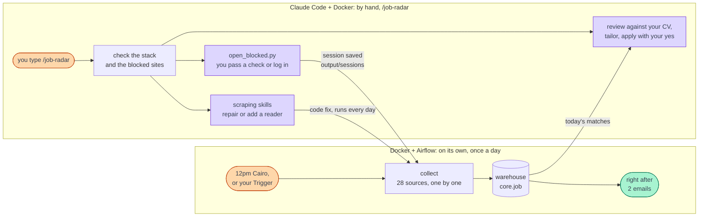
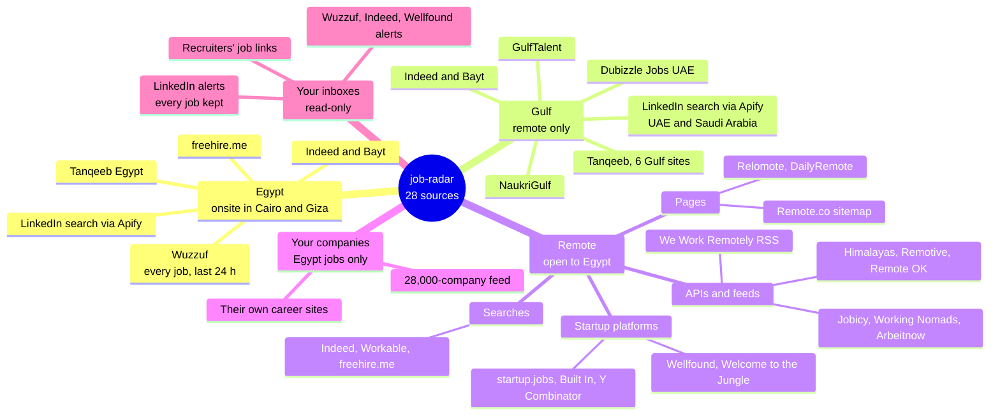
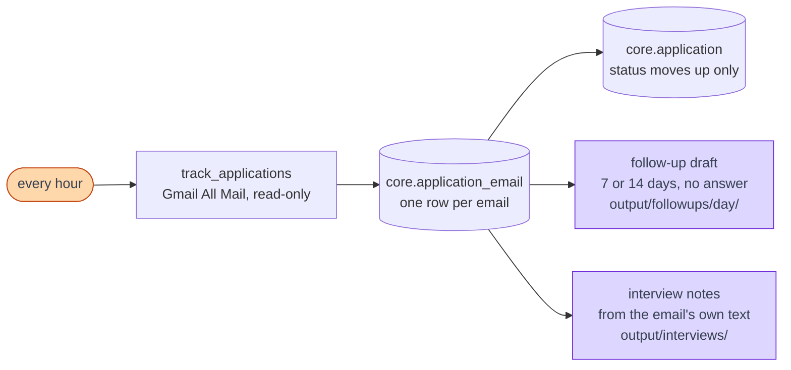
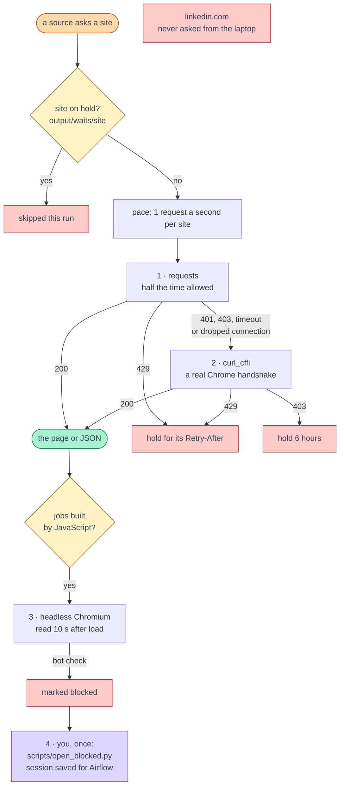

# Architecture

The picture to keep in your head is the scout in the [GUIDE](../GUIDE.md#-the-mental-model): it sweeps,
sifts, merges, ranks, and you act. This page draws the machine behind it, in four pictures, then
says where to change what. How each source is read, with the tests behind each choice, is in
[scraping-plan.md](scraping-plan.md); your companies and their Egypt jobs pages are in
[companies.md](companies.md).

## Two ways to run it

Docker and Airflow run on their own once a day; at the end of each collect Claude grades the jobs closest to your CV (20 a day, any place) and
drafts Egypt's best (each step has a switch under `features` in `settings.yaml`). Claude Code runs with you, by hand,
when you type `/job-radar`: that is where your own limit pays for what the schedule never gets, and what it
fixes or unlocks (a saved login, a repaired reader) the daily run uses from then on.

## Where the jobs come from

Grouped by your place rule: in Egypt onsite or hybrid jobs count (Cairo and Giza); everywhere else
only remote jobs.

## One collect

Twelve extract tasks run one by one, each within 150 seconds (LinkedIn's Apify run within 280), so a
busy laptop is not swamped; a task may wait up to an hour for its turn (`task_queued_timeout` 3600 in
`docker-compose.yml`), so the last extracts are never failed unrun. A whole collect takes about 15
minutes, and both emails go right after `ranked`, which runs when grade_claude has ended, red or green. embed gives each job with a description a
local vector (CV match: closeness to your CV, $0 on the CPU), grade_claude has the free models (Groq, Gemini, OpenRouter) score the closest ones, Claude only when none answers (
no daily cap, any place) 0-10 against your CV, naming a years-of-experience mismatch, and pushes an
8+ job in its first 12 hours to your phone (ntfy.sh); tailor drafts the 8+ ones in Egypt (`ai_places`) as markdown, html and
one-page PDFs, checked in code (no gap named, one page, every link kept). With `features.eligibility` on, a job someone living in Cairo cannot legally take is never stored (every extract drops it before it reaches raw.job_posting) when its board's own "who can apply" field bars Egypt or its location ties it to the USA, Canada or Europe, else hidden, not deleted:
the eligibility step (after match_skills) reads the board's own "who can apply" field where it has one (Daily Remote, Remotive, Jobicy, Remote.co, Himalayas, We Work Remotely, Relomote, Wellfound: a list without worldwide, EMEA, MENA, Africa, the Middle East, Egypt or Cairo's time zone bars it), else asks Claude Haiku once per described job outside ai_places (yes, no or unclear; only no hides; about $0.70 a month); it sets `core.job.restriction`, and the email and the tracker leave it out
(`config.hidden_reason`; the tracker's Show hidden jobs brings it back). Claude's own restriction hides a job the same way, a score of 3 or
lower hides it with `features.auto_hide`, and a status of yours shows it again. The describe step also hides a job whose page says it is closed (404, 410, Greenhouse's ?error=true, or "no longer available"). A job whose own posting has no text takes the text of the
same job from another posting seen in the last 5 days. A job first seen over 30 days ago, or a company board's job its board
stopped listing 2 days ago (once the board was read again), is archived whole in `core.job_archive` (with Claude's score and why), then deleted with its raw postings, unless you noted or applied to it (`core.job_seen` keeps its key; `core.job_history`
keeps a slim line for the Market page's trends). A job's key ignores the company's spacing, case, "and" and legal suffix.
A board that suddenly drops all its postings as not for Egypt, or none where it used to drop half, is a WARNING (`core.extract_count`);
so is a board that has given no posting at all every recorded day since its last, 7 days or more (a board that is dead, held or blocked; `steps.EMPTY_BY_DESIGN` names the three that give none by design, and a company's own `ats:token` board is not counted; `dead_boards` lists the 30-day ones once a month).
With the warehouse unreachable each step exits 99 and Airflow marks it skipped. `job_radar_backup` dumps `core` and
`raw` every night at 3am to `output/backups/` and keeps the newest 14.
Every posting is stored once (its source and link), every job once (`core.job`), every email
sends a job once. Newsletters with no jobs are remembered in `core.email_seen` for 7 days, and every step
leaves a row in `core.step_run` (the tracker's Last run page). In Docker, `output/` is a bind mount of
`E:\job-radar\output` into the airflow and tracker containers. What Claude Code writes goes there too (`E:\job-radar\output\...`); the repo's own `output/` is unused for it.

```mermaid
%% flowchart: one collect, left to right
%% clock -> schema -> 12 extract tasks one by one -> raw -> transform -> core -> describe -> match_skills
%% -> eligibility -> embed -> grade_claude -> ranked -> tailor, and match_skills -> export
%% the two email DAGs run once ranked is done (an Airflow Asset on a task that succeeds even when grade_claude fails) and read the mart view
%% check_extracts, after the extracts, turns the run red when schema or an extract did not succeed
flowchart LR
    clock(["Airflow<br>12pm Cairo,<br>or your Trigger"]):::trigger --> schema["schema<br>settings.yaml to core.company"]
    schema --> extracts
    subgraph extracts["12 extract tasks, one by one, 150 s each"]
        direction TB
        boards["extract_boards<br>Indeed"]
        bayt["extract_bayt<br>Bayt"]
        egypt["extract_egypt<br>Wuzzuf, Tanqeeb x7"]
        gulf["extract_gulf<br>NaukriGulf, GulfTalent, Dubizzle"]
        remote["extract_remote<br>10 remote boards"]
        startups["extract_startups<br>5 startup platforms"]
        freehire["extract_freehire"]
        linkedin["extract_linkedin<br>LinkedIn search via Apify,<br>once in 20 hours, 280 s"]
        workable["extract_workable<br>once a day"]
        companies["extract_companies<br>Egypt jobs only"]
        portals["extract_portals<br>28,000-company feed"]
        inbox["extract_email<br>your inboxes"]
    end
    extracts --> check["check_extracts<br>red if schema or an extract<br>did not succeed"]:::error
    extracts --> raw[("raw.job_posting<br>each posting once:<br>source + link")]
    raw --> transform["transform<br>roles, places, level<br>one row per job"]
    transform --> core[("core.job")]
    core --> describe["describe<br>descriptions from job pages"]
    describe --> match["match_skills"]
    match --> export["export_career_ops"]
    match --> eligible["eligibility<br>board field, else Haiku"]:::ai
    eligible --> embed["embed<br>local vectors"]:::ai
    embed --> grade["grade_claude<br>free models score the closest, Claude last; no daily cap"]:::ai
    grade --> ranked["ranked<br>releases the emails,<br>even if grading failed"]
    ranked --> tailor["tailor<br>drafts and PDFs for 8+"]:::ai
    core -.-> mart[("mart.job_status")]
    mart -.-> emails(["2 emails<br>right after<br>each job once"]):::success

    classDef trigger fill:#fed7aa,stroke:#c2410c,color:#374151
    classDef success fill:#a7f3d0,stroke:#047857,color:#374151
    classDef ai fill:#ddd6fe,stroke:#6d28d9,color:#374151
    classDef error fill:#fecaca,stroke:#b91c1c,color:#374151
```

## Every hour: your applications

The `job_radar_applications` DAG reads your mailbox read-only. Plain sender and subject patterns classify most
emails; Claude gets only the leftovers. An email moves its job's status up only. The two draft switches write files
and send nothing.

## Outreach sender (scheduled, but idle until settings.yaml switches it on; dry run only)

`job_radar/outreach_send.py` sends the cold emails `outreach_drafts` writes, from the Gmail accounts of `MAILBOXES`, under the
"Outreach sender" guardrails of `docs/superpowers/plans/2026-11-08-auto-apply.md`. Two DAGs in `dags/job_radar_outreach.py` run it
(below). It ships off
(`outreach.enabled: false`) and in `dry_run`: nothing leaves the laptop unless `outreach.mode` is `live` AND `outreach.enabled` is
`true`, and the file `output/outreach.stop` stops it either way. A tick (`run`) handles at most one email, so call it about every five
minutes: the gaps between emails (random, 2 to 10 minutes) are only real if ticks are shorter than that.

- `eligible(conn, now, cfg)` is read-only. It lists what the rules allow from `now`: a first email per verified contact, then the
  follow-ups due on day 7 and day 14 (a late one is skipped for good, never a third). A recipient needs a `data/contacts.csv` row whose
  source (its `source` column, else the URL ending `why`) is the company's own site or the press, never LinkedIn, an email finder or a
  guessed address; their place must map to a time zone, and mail goes only 9 to 17 there (Sunday to Thursday in Egypt and Saudi Arabia).
  A draft that names a gap, fails the humanizer check, mentions an attachment, links anywhere or poses as a reply is dropped.
- Caps: 10 a day per mailbox, 20 a day in total (Cairo day), 5 an hour. One person is mailed once, always from the mailbox that wrote
  first, in the same thread. A paused mailbox sends nothing, its follow-ups wait, and its share of the day's total (total / mailboxes) is
  removed, not given to the others.
- `run(conn, now, cfg)` in dry run writes `output/outreach/outbox/<recipient>-<n>.eml` (n = 1 first email, 2 and 3 the follow-ups) and one
  `core.outreach_send` row with mode `dry_run`; live, it commits the row first, then sends over `smtp.gmail.com:465`, so a crash can lose
  an email but never send one twice. Dry-run rows never count against live caps or history.
- `suppress_from_replies(conn, rows)` takes mail rows (the dicts `applications.read_mailbox` returns, or `core.application_email` rows,
  with `text` when there is one) and writes `core.suppression` for a reply, "no", "unsubscribe", a bounce (the failed address is read
  from the bounce's text), a spam complaint, or an out-of-office that names a new contact. A complaint, or a bounce rate over
  `outreach.bounce_limit`, writes `core.outreach_pause` (7 days) and sends an ntfy push.
- `collect_replies(conn, now, cfg)` is the reader that feeds it. For each Gmail account of `MAILBOXES` it opens All Mail read-only
  (only `BODY.PEEK`, so nothing is marked read, moved or deleted) and searches for mail from the people we mailed (20 addresses to a
  search) and for bounce and abuse notices, from the first email's day back (3 to 60 days). It keeps a reply's lines (so our quoted
  email is told from their answer) and a bounce's delivery-status part (where the failed address is named), then calls
  `suppress_from_replies`. A mailbox it cannot read is skipped and named by letter. It needs `outreach.enabled` but not a clear stop
  file: an unsubscribe that arrives while sending is stopped is still honoured. Run it about hourly; re-reading is harmless.
- The DAGs (`dags/job_radar_outreach.py`, steps `outreach_send` and `outreach_replies` of `python -m job_radar`): `job_radar_outreach`
  every 5 minutes runs one `run` tick; `job_radar_outreach_replies` at :20 every hour runs `collect_replies`. Neither retries, overlaps
  or catches up (a missed tick is not a burst of emails). With `outreach.enabled` false each task is an instant skip (exit 99) that
  never starts Python, so the DAGs cost nothing until Omar switches dry run on. The file `output/outreach.stop` skips the sender's tick
  (the reply reader ignores it). The DAG never picks the mode: settings.yaml's `outreach.mode` and `enabled` do, and the sender checks
  them again.

## What each step writes

| Step | Reads | Writes |
|---|---|---|
| `schema` | `settings.yaml`, `sql/schema.sql` | `core.company`, `core.skill`, the `mart` views |
| `extract_*` (12) | the sources | `raw.job_posting`, `core.extract_count`; `extract_email` also `core.email_seen` |
| `transform` | `raw.job_posting` | `core.job` (with `apply_url`), `core.job_history`, `core.job_seen` (the keys of jobs removed after 30 days or closed), `core.job_archive` (those jobs whole) |
| `describe` | the jobs' pages | `core.job.description` |
| `match_skills` | `core.job`, `core.cv` | `core.job_skill`, `core.cv_skill`, `core.job.years_required` |
| `eligibility` | `core.job`, its raw posting, Claude Haiku | `core.job.restriction`, `core.job.eligibility_at` (a barred job is hidden, not deleted) |
| `embed` | `core.job`, `core.cv`, a local Ollama model | `core.job_vector`, `core.cv_vector`, `core.job.cv_similarity` |
| `grade_claude` | `core.job`, `core.cv`, your last 30 clicks | `core.claude_grade` (a grade older than your newest CV upload is overwritten), `core.job.years_required` when the text gave none, a phone push |
| `tailor` | `core.claude_grade` scoring 8+ | `output/applications/<day>/` (md, html, PDFs), `core.application` as saved |
| `check_extracts` | the tasks' states | nothing: it fails the run when `schema` or an extract did not succeed |
| `track_applications` | Gmail, read-only | `core.application_email`, `core.application`, `output/followups/`, `output/interviews/` |
| `outreach_send` (every 5 min) and `outreach_replies` (hourly), DAGs `job_radar_outreach` and `job_radar_outreach_replies` | `output/outreach/*.md` drafts, `data/contacts.csv`, `core.suppression`; Gmail All Mail, read-only | dry run: `output/outreach/outbox/*.eml`, `core.outreach_send` (mode `dry_run`); live: the same row, then Gmail; replies: `core.suppression`, `core.outreach_pause` |
| `job_radar_backup` (its own DAG) | `core`, `raw` | `output/backups/nightly-<day>.dump`, the newest 14 |
| `job_radar.review weekly` (by hand, read-only) | `core.step_run`, `core.application`, `core.claude_grade`, `core.application_email` | `output/reviews/weekly-<day>.md` |
| every step | | one row in `core.step_run`: status, summary, Claude tokens and exact dollars |

## Every request

Limits first, to avoid bans: a site on hold is not asked, and every site gets at most one request a
second. A site that refuses climbs the ladder; the code never solves a check and never logs in.

## Where to change what

| You want to | Change | What happens |
|---|---|---|
| a role, a place, your level, the schedule, a smart feature on or off (`features`) | `settings.yaml` | the next run uses it; a schedule change shows in Airflow within a minute |
| add or remove a company, or its Egypt jobs page | `settings.yaml` (companies), then `.venv\Scripts\python scripts\companies_doc.py` rewrites [companies.md](companies.md) | the schema step copies the list to `core.company`; a changed link is detected again |
| LinkedIn's search words, places, jobs a run | `settings.yaml` (linkedin), `APIFY_TOKEN` in `.env` | the next Apify run, at most one every `every_hours` (20) |
| an inbox, an app password, Gmail | `.env` | `docker compose up -d` (the containers read `.env` when they start) |
| a site that shows a bot check or needs a login | run `scripts/open_blocked.py` (or `/job-radar` starts it) | your session is saved in `output/sessions/` and used by the next run |
| add a job source | a function in the module of its group in `job_radar/sources/` (`egypt.py`, `gulf.py`, `remote.py`, `boards.py`, `companies.py`, `inbox.py`) that asks through `get()` / `fetch()` from `base.py` and returns `row(...)` rows; add it to an `extract_*` step in `job_radar/steps.py` (a new step also goes in `__main__.py` STEPS and `dags/job_radar.py`) | a saved sample in `tests/fixtures/` and a test in `tests/test_sources.py`; a row in [scraping-plan.md](scraping-plan.md) |
| how fast one site is asked | `GAP` in `job_radar/sources/base.py` | 1 second unless named there |
| the email's look | `job_radar/digest.py` | the next email |
| a table or a view | `sql/schema.sql` | applied at the start of every collect |
| the tracker | `tracker/app.py` (the pages in `tracker/app_pages/`, shared data and filters in `tracker/common.py`) | refresh the page |
| what a step did last, or what Claude cost | the tracker's Last run page, or `core.step_run` | each step's latest run, 14 days of Claude dollars and failures, this month's total |

Before a change goes in: `.venv\Scripts\python -m pytest tests` (29 tests, no network, about 10 seconds): the rate limits,
every reader against a saved sample of its site, and `companies.md` against `settings.yaml`.
